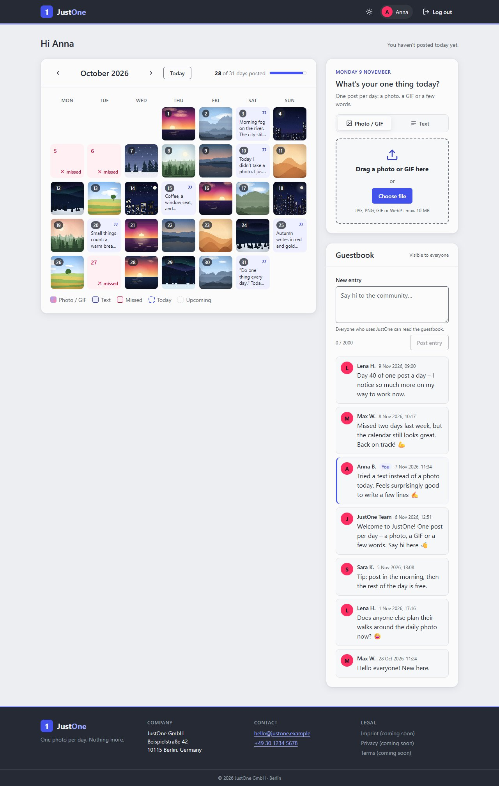
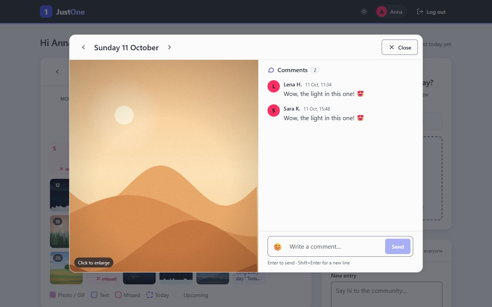
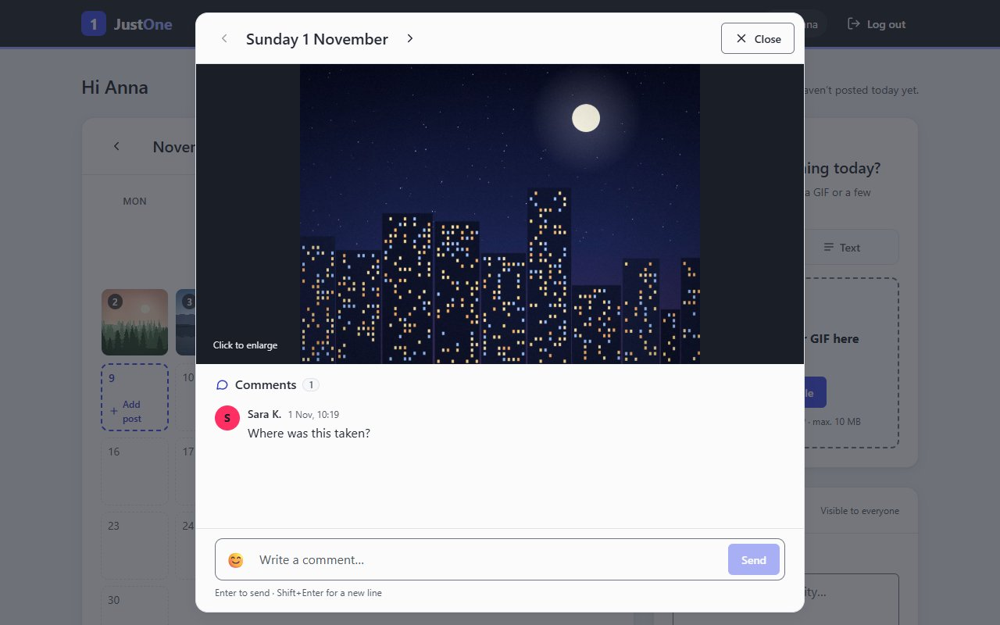
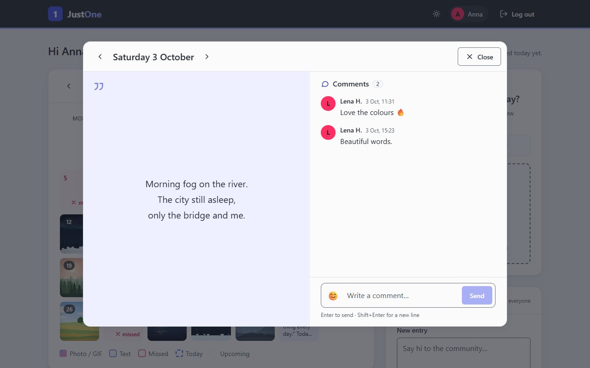
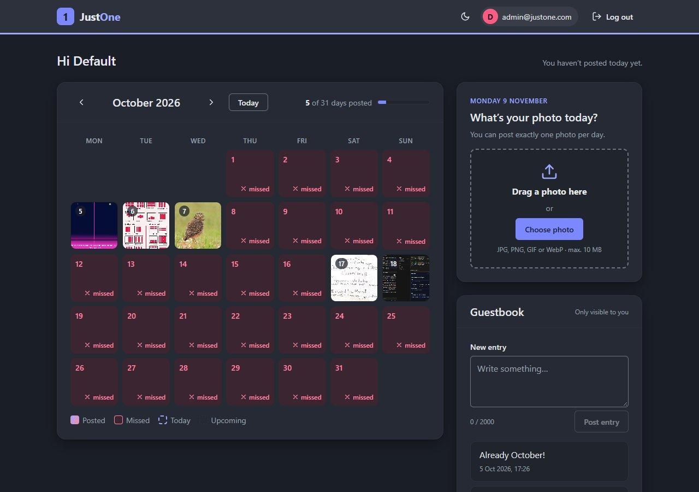
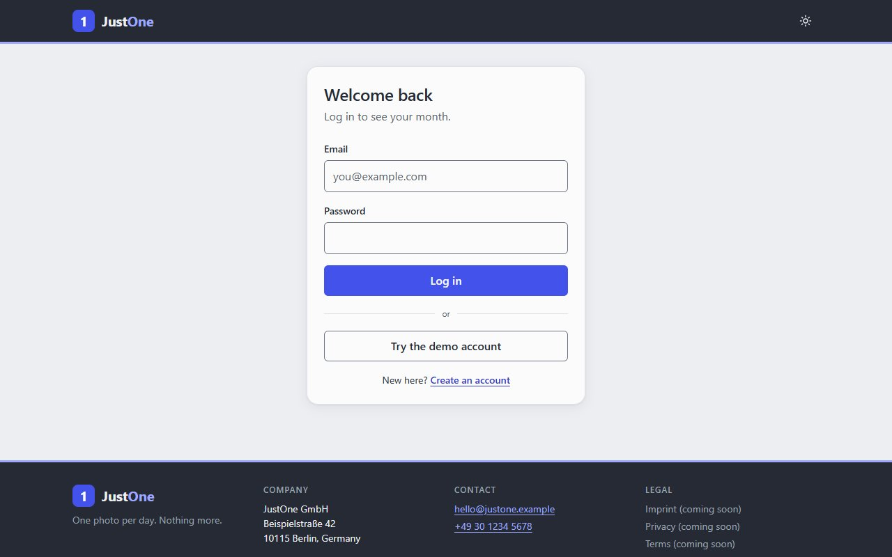
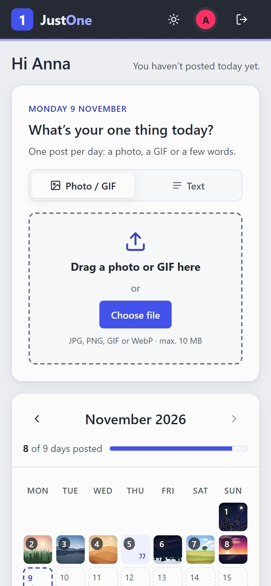
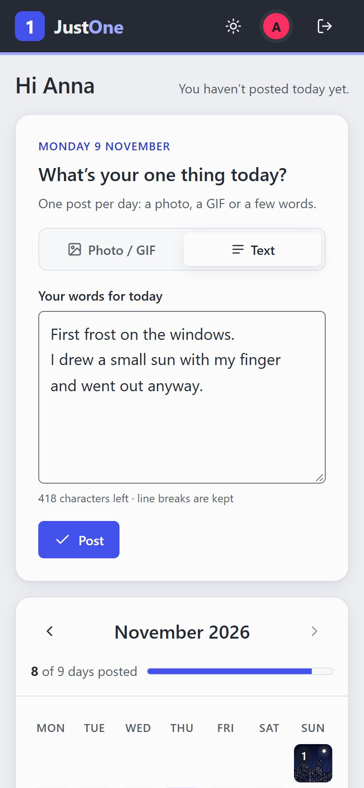

# JustOne


A social network with one simple rule: **one post per day, nothing more** – a photo, a GIF or a few words. No endless feed, no pressure to post constantly, just a daily moment collected in a monthly overview.

## Screenshots

### Monthly calendar

The month as a real calendar (Monday to Sunday) with a "days posted" counter. Photos, GIFs and text posts (with a quote mark and their first words) sit side by side; missed days are marked with an icon and text, not only by color. Next to it is the one task of the day: the "Today" card. Below it, the guestbook that everyone can read.



### Posts and comments

The post view follows the theme and adapts to the content: portrait images and texts sit next to the comments, landscape images are shown above them. Arrow keys switch to the previous/next post, Escape closes it.

| Portrait photo | Landscape image | Text post |
| --- | --- | --- |
|  |  |  |

### Dark mode

Its own dark palette (not an inverted light theme): raised surfaces get lighter, text is a soft white. The theme follows the system setting and can be switched in the header.



### Login and mobile view

Forms with visible labels, a demo-account button and error messages that explain what to do. On phones the most important card – today's post – comes first; switch between "Photo / GIF" and "Text" to write a few lines instead.

| Login | Mobile | Writing a text post |
| --- | --- | --- |
|  |  |  |

## Concept

Every user sees their month as a grid of boxes, one per day. A day's post is either an image (photo or GIF) or a short text of up to 500 characters – a poem, a thought, a quote. The box shows it; if nothing was posted, it's marked as missed. Posting is only possible for the **current day**. There's no posting for past dates.

## Features

- **Auth with JWT + refresh tokens**: short-lived access token, refresh token with rotation and theft detection (a reused, already-invalidated token automatically revokes all active sessions for that account)
- **Role system**: `Admin`, `Manager`, `User`; Manager and Admin can moderate other users' posts (replace the image or delete it)
- **Self-registration**: new accounts always start as `User`; role upgrades only by an admin
- **Monthly calendar**: dynamic day count per month, navigation from January to the current month, counter of posted days
- **One post per day**: enforced server-side (not just in the frontend), including change/delete for today's post
- **Photo, GIF or text**: today's post can be an image (animated GIFs included) or up to 500 characters of text; it can be switched between both later
- **Time-zone aware**: "today" is determined in the user's own time zone (sent by the browser), not in UTC
- **Safe uploads**: only JPG, PNG, GIF and WebP images up to 10 MB are accepted
- **Daily comments**: comments attached directly to a post, with author display
- **Public guestbook**: everyone sees all entries; authors are shown as "First name + initial", never by email (comments too)
- **Comment box**: auto-growing text field, emoji picker, Enter to send, character counter
- **Feedback for every state**: skeletons while loading, errors with a "Try again" action, confirmation before deleting, toasts after posting
- **Dark mode**: follows the system, switchable (system / light / dark) in the header
- **Accessible**: WCAG AA contrast for all text, keyboard-operable calendar and dialogs, visible focus, labelled form fields, `prefers-reduced-motion` respected
- **Responsive design**: two columns on desktop, one column on phones with today's task first

## Design

The design follows common UI/UX guidelines (Nielsen heuristics, WCAG, 60-30-10 color rule). The mockups and the reasoning behind them are in [`docs/mockups`](docs/mockups/index.html).

All colors are defined once as fixed scales (50–900) in [`theme.css`](vue-frontend/src/assets/theme.css). Components only use semantic roles such as `--accent`, `--surface` or `--missed`, so light and dark mode switch automatically.

| Color | Base | Role |
| --- | --- | --- |
|  Indigo | `#5b6cff` | primary color: logo, primary buttons, links, focus, today, progress |
|  Pink | `#ff2e63` | secondary color: missed days, avatars |
|  Gray | `#252a34` | text, header and footer, dark mode surfaces |
|  Red | `#c42b2b` | errors and delete only (independent of the brand) |

Typography: one system font stack (Segoe UI, SF Pro, Roboto …), sizes in `rem` from 12 to 32 px, body text 16 px with line height 1.5.

## Tech Stack

**Backend:** ASP.NET Core 10 (controller-based Web API), Entity Framework Core with SQLite, ASP.NET Core Identity, JWT bearer auth with refresh token rotation, Swagger/Swashbuckle

**Frontend:** Vue 3 (Composition API), Vite, Pinia, Axios

## Project Structure

```
JustOne/
├── asp-backend/               # ASP.NET Core backend
│   ├── Controller/            # Auth, Posts, Comments, Guestbook
│   ├── Entities/              # Post, Comment, RefreshToken, GuestbookEntry, ...
│   ├── Models/                # Request/response DTOs
│   ├── Data/                  # AppDbContext, DbSeeder, DemoDataSeeder
│   ├── Migrations/            # EF Core migrations
│   ├── SeedData/              # Generated demo photos and GIFs (demo mode)
│   └── Auth/                  # JWT settings, TokenService
├── docs/                      # Screenshots for this README, design mockups
└── vue-frontend/              # Vue 3 frontend
    └── src/
        ├── components/        # AppHeader, AppFooter, PostCalendar, TodayCard, ImageModal,
        │                      # Comments, Guestbook, Login, Register, ConfirmDialog, ToastHost
        ├── assets/            # theme.css (design tokens: colors, type, spacing; light + dark)
        ├── composables/       # usePostCalendar, useTheme, useToast
        ├── stores/            # auth (Pinia)
        └── api/               # Axios client with auth interceptor
```

## Setup

### Prerequisites

- [.NET 10 SDK](https://dotnet.microsoft.com/download) and the EF Core CLI: `dotnet tool install --global dotnet-ef`
- [Node.js](https://nodejs.org/) 22.18+ or 24.12+

### Backend

```bash
cd asp-backend
dotnet restore
dotnet ef database update
dotnet run
```

The API runs at `http://localhost:5250` (the address the frontend expects), Swagger UI at `http://localhost:5250/swagger`.

On first start the roles and a demo admin account are seeded:

| Email | Password | Role |
| --- | --- | --- |
| `admin@justone.com` | `Admin123!` | Admin (moderation) |
| `anna@justone.com` | `Demo123!` | User – used by the "Try the demo account" button |

### Demo data (optional)

To see the app with content – like in the screenshots – start the backend in demo mode. It uses its own database (`demo.db`), so your normal data stays untouched:

```bash
cd asp-backend
dotnet run -- --DemoData:Enabled=true --ConnectionStrings:DefaultConnection="Data Source=demo.db"
```

On the first start this creates three friends for Anna (`lena@`, `max@`, `sara@justone.com`, password `Demo123!`) and fills the previous and the current month for all four with photos, GIFs and short texts (only 2–3 missed days per user, today stays open), plus comments and guestbook entries. Photos and GIFs are generated illustrations from [`asp-backend/SeedData`](asp-backend/SeedData) – no third-party images. Delete `demo.db` to start over. Demo mode only works in the Development environment.

### Frontend

```bash
cd vue-frontend
npm install
npm run dev
```

The app runs at `http://localhost:5173`.

## Status

Actively in development, a portfolio project built for software developer job applications.