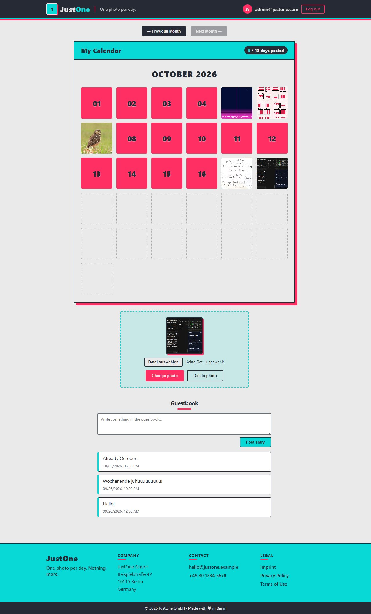
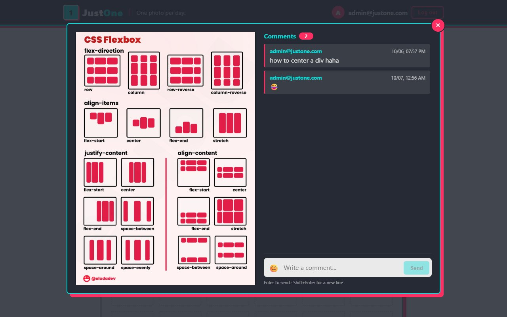
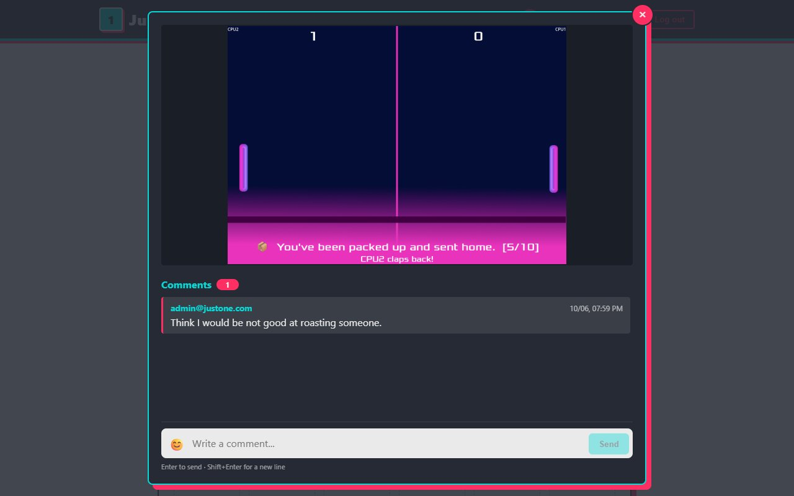
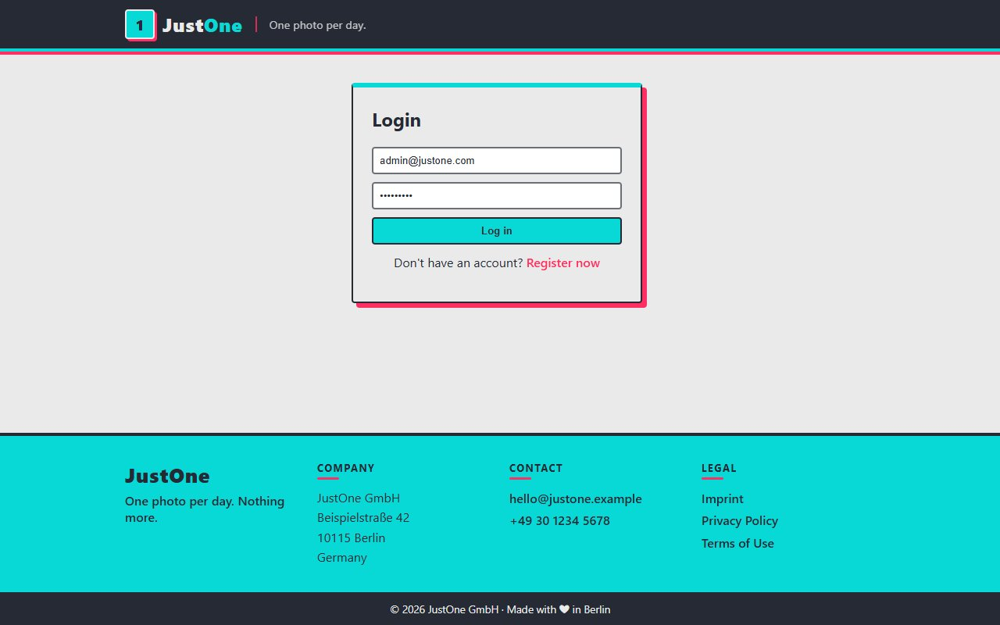
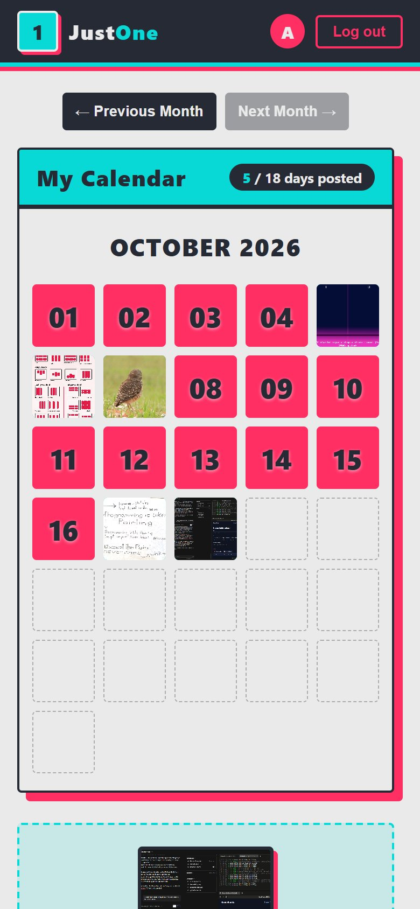

# JustOne


A social network with one simple rule: **one photo per day, nothing more.** No endless feed, no pressure to post constantly, just a daily snapshot collected in a monthly overview.

## Screenshots

### Monthly calendar

The whole page: sticky header, month navigation, the calendar with a "days posted" counter, the upload box for today's photo, the guestbook and the footer.



### Comments

The post view adapts to the photo: portrait images sit next to the comments, landscape images are shown above them.

| Portrait photo | Landscape photo |
| --- | --- |
|  |  |

### Login and mobile view

The login page shares the header and footer. On phones the calendar switches to a compact five-column grid.

| Login | Mobile |
| --- | --- |
|  |  |

## Concept

Every user sees their month as a grid of boxes, one per day. If a photo was posted, the box shows it. If not, it's marked empty. Posting is only possible for the **current day**. There's no posting for past dates.

## Features

- **Auth with JWT + refresh tokens**: short-lived access token, refresh token with rotation and theft detection (a reused, already-invalidated token automatically revokes all active sessions for that account)
- **Role system**: `Admin`, `Manager`, `User`; Manager and Admin can moderate other users' posts (replace the image or delete it)
- **Self-registration**: new accounts always start as `User`; role upgrades only by an admin
- **Monthly calendar**: dynamic day count per month, navigation from January to the current month, counter of posted days
- **One post per day**: enforced server-side (not just in the frontend), including change/delete for today's post
- **Time-zone aware**: "today" is determined in the user's own time zone (sent by the browser), not in UTC
- **Safe uploads**: only JPG, PNG, GIF and WebP images up to 10 MB are accepted
- **Daily comments**: comments attached directly to a post, with author display
- **Guestbook**: a dedicated section below the calendar
- **Comment box**: auto-growing text field, emoji picker, Enter to send, character counter
- **Responsive design**: sticky header with user menu, footer, hover/focus states and a dedicated mobile layout

## Design

All colors come from one palette, defined once as CSS variables in [`theme.css`](vue-frontend/src/assets/theme.css) and used by every component:

| Color | Hex | Used for |
| --- | --- | --- |
|  Cyan | `#08d9d6` | header accents, calendar header, footer, primary buttons |
|  Dark | `#252a34` | header, text, borders, modal background |
|  Pink | `#ff2e63` | missed days, offset shadows, hover states, errors |
|  Light | `#eaeaea` | page background, text on dark surfaces |

## Tech Stack

**Backend:** ASP.NET Core 10 (controller-based Web API), Entity Framework Core with SQLite, ASP.NET Core Identity, JWT bearer auth with refresh token rotation, Swagger/Swashbuckle

**Frontend:** Vue 3 (Composition API), Vite, Pinia, Axios

## Project Structure

```
JustOne/
├── asp-backend/               # ASP.NET Core backend
│   ├── Controller/            # Auth, Posts, Comments, Guestbook
│   ├── Entities/              # Post, Comment, RefreshToken, GuestbookEntry, ...
│   ├── Models/                # Request/response DTOs
│   ├── Data/                  # AppDbContext, DbSeeder
│   ├── Migrations/            # EF Core migrations
│   └── Auth/                  # JWT settings, TokenService
├── docs/                      # Screenshots for this README
└── vue-frontend/              # Vue 3 frontend
    └── src/
        ├── components/        # AppHeader, AppFooter, Login, Register, PostCalendar,
        │                      # PostUpload, Comments, Guestbook, ImageModal
        ├── assets/            # theme.css (color palette as CSS variables)
        ├── composables/       # usePostCalendar
        ├── stores/            # auth (Pinia)
        └── api/               # Axios client with auth interceptor
```

## Setup

### Prerequisites

- [.NET 10 SDK](https://dotnet.microsoft.com/download) and the EF Core CLI: `dotnet tool install --global dotnet-ef`
- [Node.js](https://nodejs.org/) 22.18+ or 24.12+

### Backend

```bash
cd asp-backend
dotnet restore
dotnet ef database update
dotnet run
```

The API runs at `http://localhost:5250` (the address the frontend expects), Swagger UI at `http://localhost:5250/swagger`.

On first start the roles and a demo admin account are seeded:

| Email | Password | Role |
| --- | --- | --- |
| `admin@justone.com` | `Admin123!` | Admin |

### Frontend

```bash
cd vue-frontend
npm install
npm run dev
```

The app runs at `http://localhost:5173`.

## Status

Actively in development, a portfolio project built for software developer job applications.