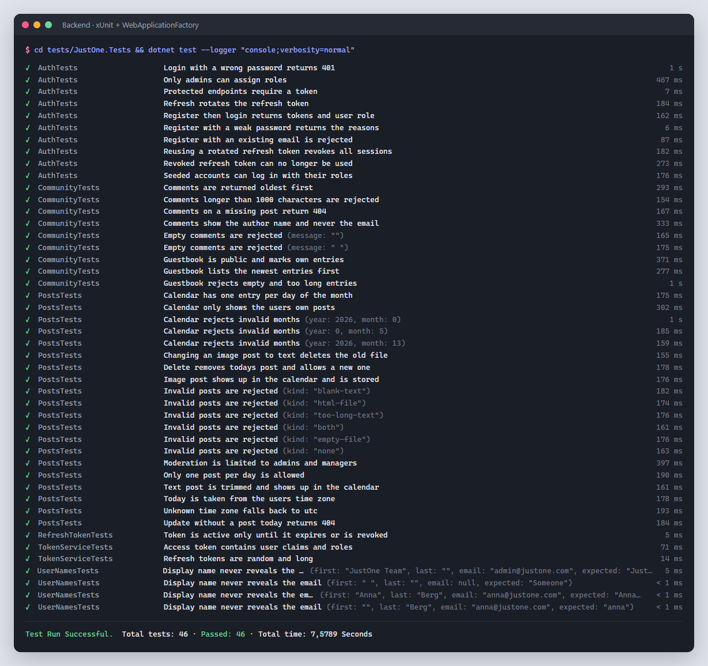
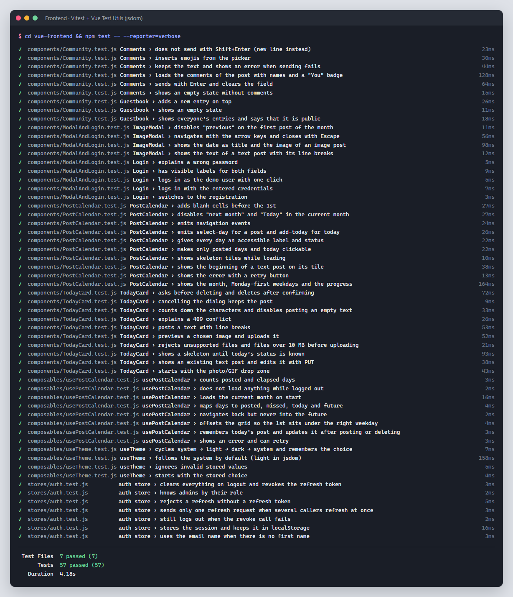

# Tests

JustOne has automated tests for both halves of the app: **46 backend tests** (xUnit) and **57 frontend tests** (Vitest). All of them run without a browser, without a real database and without network access – a full run takes about 10 seconds.

| | Backend | Frontend |
| --- | --- | --- |
| Framework | xUnit, `Microsoft.AspNetCore.Mvc.Testing` | Vitest, Vue Test Utils, jsdom |
| Location | [`tests/JustOne.Tests`](tests/JustOne.Tests) | [`vue-frontend/tests`](vue-frontend/tests) |
| Kind | Integration tests through the real HTTP pipeline + unit tests | Component and logic tests with a mocked API |
| Tests | 46 ✓ | 57 ✓ |

## Running the tests

### Backend

```bash
cd tests/JustOne.Tests
dotnet test
```

The test project starts the real API in memory (`WebApplicationFactory<Program>`). Every test class gets its own **in-memory SQLite database** with all migrations applied, and uploaded files go to a **temporary folder** that is deleted afterwards – your `justone.db` and `wwwroot/uploads` are never touched. The seeded accounts (`admin@justone.com`, `anna@justone.com`) exist in every test database, just like in the app.

### Frontend

```bash
cd vue-frontend
npm test            # run once
npm run test:watch  # re-run on every change
```

Components are mounted in jsdom. The Axios client is replaced by mocks, so the tests decide exactly what "the server" answers – including errors and conflicts.

## What is tested

### Backend

**Authentication** – [`AuthTests.cs`](tests/JustOne.Tests/AuthTests.cs)

| Test | Checks |
| --- | --- |
| Register → login | Tokens are issued, new accounts always get the `User` role, first name is returned |
| Duplicate email, weak password | Rejected with `400`, Identity's reasons are returned |
| Wrong password | `401` |
| Seeded accounts | Admin and demo user can log in with the right roles |
| Protected endpoints | `401` without a token |
| Refresh rotation | Every refresh returns a new refresh token |
| Theft detection | Reusing a rotated token returns `401` **and** revokes the new one as well |
| Revoke | A revoked token can't be refreshed any more |
| Roles | Only admins can assign roles (`403` for users, `400` when assigned twice) |

**Posts** – [`PostsTests.cs`](tests/JustOne.Tests/PostsTests.cs)

| Test | Checks |
| --- | --- |
| Image post | Stored in the upload folder and shown in the calendar |
| Text post | Trimmed, line breaks kept, shown in the calendar |
| One post per day | Second post on the same day → `409` |
| Invalid posts (6 cases) | Image **and** text, nothing at all, blank text, > 500 characters, `.html` file, empty file → `400` |
| Image → text | Changing the post deletes the old image file |
| Update / delete | `404` without a post today; after deleting, a new post is possible |
| Time zones | "Today" comes from the `X-Timezone` header (UTC+14 vs. UTC−12 are different days); unknown zones fall back to UTC |
| Calendar | Invalid months → `400`, one entry per day (29 days in February 2028), only your own posts |
| Moderation | Strangers get `403`, admins may delete any post |

**Comments and guestbook** – [`CommunityTests.cs`](tests/JustOne.Tests/CommunityTests.cs)

| Test | Checks |
| --- | --- |
| Author names | Comments and guestbook show "First name + initial" and **never** the email address (checked against the raw JSON) |
| Own entries | `isOwn` is only true for the author |
| Order | Comments oldest first, guestbook newest first |
| Validation | Empty comments, comments > 1000 and guestbook entries > 2000 characters → `400` |
| Missing post | Comments on a non-existent post → `404` |
| Public guestbook | Entries of one user are visible to everybody |

**Unit tests** – [`UnitTests.cs`](tests/JustOne.Tests/UnitTests.cs)

| Test | Checks |
| --- | --- |
| `UserNames.Display` | Name formats incl. missing last/first name – never the full email |
| `TokenService` | Access token contains subject, name, all roles, issuer and the configured lifetime; refresh tokens are random 64-byte values |
| `RefreshToken.IsActive` | Active only while neither expired nor revoked |

### Frontend

**Logic** – [`stores/auth.test.js`](vue-frontend/tests/stores/auth.test.js), [`composables/`](vue-frontend/tests/composables)

| Test | Checks |
| --- | --- |
| Auth store | Session is stored and restored, display name falls back to the email name, admins are recognised |
| Concurrent refresh | Two parallel refreshes send **one** request (otherwise the backend would see token theft) |
| Logout | Clears everything, revokes the refresh token, still works when the server is offline |
| `usePostCalendar` | Days become posted / missed / today / future; image URLs get the backend origin; text posts keep their text |
| Calendar grid | Leading blanks for the weekday of the 1st (Nov 2026 → 6, Oct 2026 → 3) |
| Navigation | Never into the future, "Today" jumps back, each month is loaded once |
| Today's post | Updated optimistically after posting/deleting |
| Errors | Error message on failure, `retry()` loads again |
| `useTheme` | System → light → dark → system, remembered in `localStorage`, invalid values ignored |

**Components** – [`components/`](vue-frontend/tests/components)

| Component | Checks |
| --- | --- |
| `PostCalendar` | Monday-first weekdays, progress, accessible labels for every day, only posts and today are buttons, text excerpt on the tile, events, skeleton while loading, error with "Try again" |
| `TodayCard` | Photo/GIF ↔ text switch, character counter, empty text can't be posted, text sent as form field, image preview + upload, wrong type and > 10 MB rejected **before** uploading, `409` explained, editing an existing post uses `PUT`, delete only after confirming, cancel keeps the post |
| `ImageModal` | Date as title, image or text (with line breaks), arrow keys navigate, Escape closes, "previous" disabled on the first post |
| `Comments` | Names and "You" badge, empty state, **Enter** sends, **Shift+Enter** doesn't, text is kept when sending fails, emoji picker |
| `Guestbook` | Public hint, everyone's entries, own entry marked, new entry on top, empty state |
| `Login` | Visible labels, login with the entered data, demo button logs in as Anna, wrong password explained, switch to registration |

## Results

### Backend – 46 passed



### Frontend – 57 passed



## Not covered yet

- **End-to-end tests** in a real browser (e.g. Playwright) that click through login → post → comment against a running backend. The screenshots in the README are made that way, but without assertions.
- The `Register` component and the moderation endpoint that **replaces** another user's image (`PUT /api/posts/{id}`).
- Automated accessibility checks (e.g. axe) – contrast and labels are covered by the design tokens and the component tests above, but not scanned.
- Code coverage reports (`dotnet test --collect:"XPlat Code Coverage"` and `@vitest/coverage-v8` would add them).
